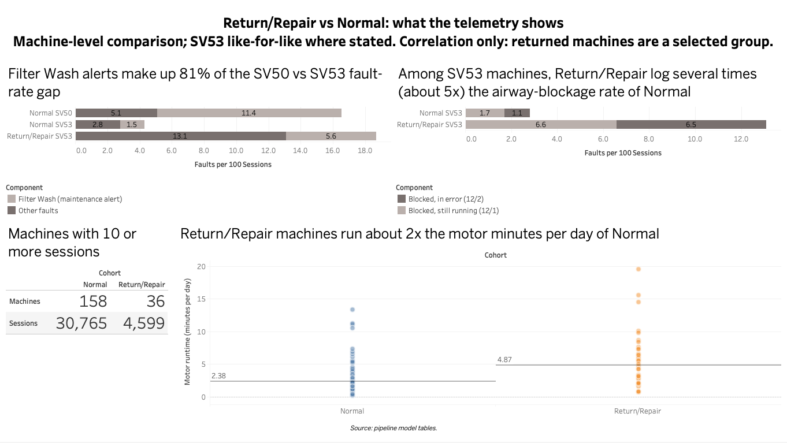
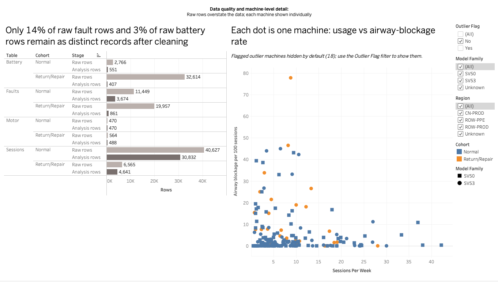

# Telemetry & Product Data Analytics Take-Home

## 1. Overview

Two cohorts of connected vacuum cleaners, Normal and Return/Repair (RR), send clean-session, fault, motor and battery telemetry. The assignment: assess data quality, build a data model (with a productionisation sketch), find a small number of well-supported insights, and present them in a report and a dashboard.

| Deliverable | Where |
|---|---|
| Analysis report (title, contents, 5 sections; 7 pages) | `reports/telemetry_findings.pdf` |
| Code repository | this repo (`src/`, `notebooks/`, this README) |
| Dashboard (Tableau) | `dashboard/screenshots/01_findings.png` (insights dashboard) and `dashboard/screenshots/02_dq_explorer.png` (data quality explorer). The Tableau workbook is not committed (it embeds data). Dashboard data: `dashboard/data/insights_dashboard.csv`, described in `dashboard/data/README_dashboard.md` |
| Assumptions and limitations log | `docs/assumptions_log.md` |

Also: `docs/worklog.md` (activity log), `docs/erd.md` (data model), `docs/productionization.md` (ingestion to BI sketch), `docs/parsing_spec.md` (payload parsing).

## 2. Setup

- **Python.** 3.8.1 (the version the results were produced on; a newer Python should work but `requirements.txt` was resolved on 3.8.1). Main packages: pandas 2.0.3, duckdb 1.3.2, matplotlib 3.7.5, numpy 1.24.4, jupyter 1.1.1. Parquet is read and written through DuckDB.

```bash
python3 -m venv .venv
source .venv/bin/activate
pip install -r requirements.txt
```

- **Data (not included).** The company-provided inputs are git-ignored and are not redistributed. Place them at the repo root before running anything:

| Path | Content |
|---|---|
| `normal_machines/` | the 4 Normal-cohort CSVs (clean sessions, faults, motor, battery) |
| `return_repair_machines/` | the 4 Return/Repair-cohort CSVs |
| `reference_files/` | `DDM_Bins.json` and `BMS_Bins.json` |
| `take_home_assignment_details.pdf` | the assignment brief (source of field and fault meanings) |

Raw files are never modified.

## 3. How to run

```bash
python src/run_all.py                 # everything, in order; about 3 minutes
python src/run_all.py --from insights # restart at a named step
```

Steps run in order: profile, inspect, dups, cumulative, spec, links, bands, clean, dq, model, insights, candidates, round2, final, charts, decknumbers, tableau, dashboard. The first failing check stops the run. The pipeline is deterministic (bootstrap seed fixed), so a rerun reproduces `key_numbers.csv`.

| Output | Folder |
|---|---|
| Parsed tables (Parquet) and flagged tables with `is_analysis_row` | `data/clean/`, `data/clean/dq/` (generated, git-ignored) |
| Star schema (Parquet and CSV) and Tableau CSVs | `data/model/`, `data/model/tableau/` (generated, git-ignored) |
| Profiling, DQ and model checks | `reports/profiling/`, `reports/dq/` (`dq_summary.csv`), `reports/model/` |
| All reported numbers, deck number sheet, insight write-ups | `reports/insights/` (`key_numbers.csv`, `deck_numbers.md`, `insight_cards.md`) |
| Final charts | `reports/figures/final_v2/` |
| Dashboard data | `dashboard/data/insights_dashboard.csv` |

Optional notebook (run from `notebooks/`): `01_eda_shortlist.ipynb` (first-round EDA; writes `reports/eda/shortlist.md`).

## 4. Where to find each part

| Brief item | Where | Key functions |
|---|---|---|
| Data processing: parsing and cleaning | `src/build_clean.py`, `src/payload_parsers.py`, `src/payload_io.py`, `src/field_meanings.py` (all field meanings, units and bin mappings) | `build_typed`, `build_motor`, `build_battery`, `build_machine_lookup` (build_clean); `parse_motor`, `parse_battery` (payload_parsers) |
| Data processing: star schema | `src/model.py`; ERD in `docs/erd.md`; productionisation sketch in `docs/productionization.md` | `build_dim_machine`, `build_dim_date`, `build_fact_session`, `build_fact_fault`, `build_fact_motor_period`, `build_fact_battery_period`, `build_machine_summary` |
| Data quality checks | `src/dq.py` (summary rows via `summarise`; output `reports/dq/dq_summary.csv` and detail CSVs); profiling in `src/profile.py`, `src/dup_diagnostics.py`, `src/cumulative_check.py`, `src/link_checks.py` | `check_duplicates_sessions`, `check_duplicates_faults`, `check_duplicates_payload`, `check_invalid_sessions`, `check_counter_decreases`, `check_coverage`, `check_fault_codes`, `check_outliers_rows` |
| Analysis | `src/insights_final.py` (final insights I1 to I4, `f_` rows) built on `src/insights.py`, `src/insights2.py`, `src/insights3.py`; notebooks in `notebooks/`; charts in `src/charts_final.py` | `build_i1`, `build_i2`, `build_i3`, `build_i4` (insights_final) |
| Feature engineering | see below | |
| Dashboard | `src/make_dashboard_data.py` → `dashboard/data/insights_dashboard.csv` → Tableau (workbook not in repo); machine-level and DQ views from `src/tableau_export.py` | `build`, `check` (make_dashboard_data) |

Feature engineering, by function:
- **Counters to period deltas:** `build_periods` (with `build_fact_motor_period`, `build_fact_battery_period`) in `src/model.py`: `days_elapsed`, `delta_valid`, and missing deltas when a counter decreases.
- **Rates per 100 cleans:** `pooled_ci` in `src/insights.py` and `compare_pooled` in `src/eda_helpers.py` (pooled rate, machine bootstrap, `scale=100`).
- **Duplicate classes** (`exact_copy`, `join_fanout`, `reupload`, `distinct`, plus `dup_keep`): assigned in the SQL of `build_sessions_stage_a`, `build_faults` and `_build_payload_table` in `src/dq.py`, reported by the `check_duplicates_*` functions.
- **Fault-to-session linking:** `build_fact_fault` in `src/model.py` (nearest session date, `session_key`) and `link_faults` in `src/insights2.py` (serial + `session_id`, server dates within 24 h; used for I1 and I4).
- **Flags:** `add_machine_outlier_flags` and `check_invalid_sessions` in `src/dq.py`; `is_analysis_row` set in the `data/clean/dq/` tables.

## 5. Approach

`raw` (read-only CSVs and bin JSONs) → `clean` (`build_clean.py`: lossless typing and payload parsing, one output row per raw row with `source_file` and `source_row`) → `dq` (`dq.py`: classify and flag, never delete; `is_analysis_row`) → `model` (`model.py`: star schema) → `insights` (`insights*.py`; every reported number is a row in `reports/insights/key_numbers.csv`) → `dashboard data` (`make_dashboard_data.py`, copied from the `f_` rows by id, with a pass/fail check). Cohort is a column, not a code path. Field meanings, units and bin mappings live in one module, `src/field_meanings.py`; the only sources are the brief and the two bin JSONs.

**Star schema** (`docs/erd.md` has the ERD and keys):

| Table | Grain (one row is...) |
|---|---|
| `dim_machine` | one machine (`anonymized_serial`), with cohort, model, region, pack type and presence flags |
| `dim_date` | one calendar day |
| `fact_session` | one analysis session: serial + `session_id` + `date_server` after the duplicate rules |
| `fact_fault` | one fault occurrence under the primary rule (serial, `session_id`, `fault_type`, `fault_value`, `fault_timestamp`) |
| `fact_motor_period` | one interval between two consecutive analysis motor snapshots of a machine (cumulative counters turned into deltas) |
| `fact_battery_period` | the same, for battery snapshots |
| `machine_summary` | one machine, with per-machine metrics and their sample sizes |

Counters are cumulative lifetime values: each period row is the difference between consecutive snapshots of one machine, with `days_elapsed`; a counter decrease marks the whole period invalid rather than assuming a reset. Comparisons use machines as the unit (pooled rates, 95% bootstrap over machines, fixed seed).

## 6. Data quality summary

Source: `reports/dq/dq_summary.csv` (one row per check, table and cohort) and the `dq_` rows of `key_numbers.csv`.

- **Heavy duplication; rows are classified, not deleted.** Analysis rows as a share of raw rows: clean sessions 75.9% Normal and 70.7% RR; faults 32.1% and 4.3%; battery 19.9% and 1.2%; motor 100% and 86.5% (`dq_pct_kept_*`). Exact copies are 78.3% of raw fault rows (`dq_exact_copy_faults_all`).
- **Empty battery payloads** are 94.8% of raw battery rows (`dq_empty_battery_all`), so battery data are thin.
- **Other checks** (sentinel dust values, out-of-range charge values, counter decreases, future device timestamps, schema differences between cohorts, join fan-out) are in `reports/dq/` and the assumptions log.

## 7. Findings (deck order)

All results are exploratory. Every number is a row in `reports/insights/key_numbers.csv` (id in brackets); `reports/insights/deck_numbers.md` has the full set with intervals, machine counts and robustness checks.

1. **Filter Wash reminders flag, and come before, airway blockages.** Sessions with a Filter Wash alert have a blockage in 11.8% vs 0.9% without one, about 6x on the same machine (6.0x [4.3 to 8.6], `f_i1_samesession_rr_all`). Blockage episodes are about 3x as frequent in the 7 days after an alert (2.8x, 3.0x, 3.4x for Normal SV50, Normal SV53, RR SV53; `f_i1_lead_adjratio_sessionspan_7d_*`); the excess is smaller when the alert's own session is excluded and weaker over 30 days, so treat anything beyond 7 days as not established.
2. **The SV53 rarely warns before a blockage error.** Among Normal machines, 27% of SV53 error sessions had an earlier warning vs 92% for SV50 (`f_i4_prior121_share_normal_SV53`, `f_i4_prior121_share_normal_SV50`; difference 65.2 pp [47.5 to 82.5], `f_i4_prior121_diff_sv50_minus_sv53_normal`). Escalation share and timing do not separate the models.
3. **Returned SV53s log 3–5x more blockages, led by SV53-AB.** RR/Normal ratio 4.7x as recorded [1.5 to 14.1] and 3.1x [1.3 to 9.3] with the same sub-model mix (`f_i3_crude_ratio`, `f_i3_std_ratio`). The two intervals overlap; SV53-AB runs 8.2 blockages per 100 sessions vs 0.6 to 2.3 for the other sub-models (`f_i3_rate12_normal_SV53_*`).
4. **The SV50 often sends no battery temperature, and no dust or motor data.** No temperature flag in 74% of SV50 cleans vs 3% for SV53 (`f_i2_notrep_pct_normal_SV50`, `f_i2_notrep_pct_normal_SV53`). Battery heat is a lead only: 9 of 15 SV50 vs 5 of 42 SV53 machines show discharge above 45 C (`f_i2_any_hot_machines_*`), low confidence.

Supporting material: robustness checks in `reports/insights/deck_numbers.md`, final insight cards in `reports/insights/insight_cards.md` (sections I1 to I4), charts in `reports/figures/final_v2/`, dashboard data in `dashboard/data/insights_dashboard.csv`.

## 8. Dashboard

**Live dashboard: https://public.tableau.com/views/telemetry_dashboard_public/Dashboard1?:language=en-GB&publish=yes&:sid=&:redirect=auth&:display_count=n&:origin=viz_share_link**

The Tableau workbook is not committed (it embeds data). Data source for the insights view: `dashboard/data/insights_dashboard.csv` (aggregates only, copied by id from `key_numbers.csv`; column and chart descriptions in `dashboard/data/README_dashboard.md`). The data quality view uses `tableau_dq_volume.csv` (row counts) and `tableau_machines.csv` (machine-level dots), both written by `src/tableau_export.py` into `data/model/tableau/` (generated, git-ignored, not published).



**`01_findings.png` — Insights 1–4, one panel per insight.** Insight 1 compares the share of cleans with an airway blockage with and without a Filter Wash reminder (11.8% vs 0.9%); the panel title carries the ~6x same-clean and ~3x 7-day figures. Insight 2 shows the share of blockage errors preceded by a warning, SV50 against SV53 (92% vs 27%). Insight 3 shows blockages per 100 cleans by SV53 sub-model (SV53-AB highest) and the returned-to-normal ratio as recorded and with the same sub-model mix. Insight 4 shows the share of cleans with no battery temperature (SV50 74%, SV53 3%) with a footnote on the low-confidence hot-battery counts (9 of 15 SV50 vs 5 of 42 SV53 batteries above 45 °C). All intervals are 95% machine bootstraps.



**`02_dq_explorer.png` — raw vs usable rows, plus one dot per machine.** Left: for each table (clean sessions, faults, motor, battery) and cohort, bars compare raw rows with the rows kept for analysis after duplicates and empty payloads are flagged (for example faults: 32.1% of raw Normal rows and 4.3% of raw RR rows are kept; `dq_pct_kept_*` in `key_numbers.csv`). It shows why raw row counts must not be used as event counts. Right: each dot is one machine, sessions per week against airway blockages per 100 sessions, with filters for outlier flag, model family and region. It is machine-level and built from `tableau_machines.csv`, so it is a descriptive view, not a finding.

The dashboard shows correlation only; Return/Repair is a selected population.

## 9. Assumptions and limitations

Full log: `docs/assumptions_log.md` (each row marked verified, assumed or inferred).

- **Selected population.** RR machines were returned or repaired for reasons and on dates that are not in the data; differences describe that group, not a typical machine. Samples are small.
- **Correlation only.** Nothing here states or implies a cause; event order uses `fault_timestamp` (device time), which is inferred.
- **Unknown field meanings.** `fault_status`, `hex_error_code`, `log_type`, the time-sync columns, sub-model codes and battery snapshot units are not defined in the brief or the bin JSONs; findings do not depend on them.
- **The SV50 is missing data.** No dust values, no motor logs, battery data for only 15 machines and no RR machines, so SV50 can only be compared on faults and sessions (`f_i2_ctx_*`).
- **Intervals** are 95% bootstraps over machines (2,000 resamples, fixed seed); several comparisons were run with no multiplicity correction.
- **Model, not cohort.** Normal vs RR comparisons are restricted to SV53 because RR has no SV50 machines.

## 10. Repo layout

```
normal_machines/, return_repair_machines/, reference_files/   raw inputs (company-provided, git-ignored, not included)
take_home_assignment_details.pdf                              brief (git-ignored, not included)
src/             pipeline scripts (run_all.py runs them in order) and field_meanings.py
notebooks/       01_eda_shortlist.ipynb
data/clean/      parsed and flagged tables      (generated, git-ignored)
data/model/      star schema, tableau/ CSVs     (generated, git-ignored)
reports/         profiling/, dq/, model/, eda/, insights/, figures/ (final_v2/ = final charts), telemetry_findings.pdf
dashboard/       screenshots/, data/ (insights_dashboard.csv, README_dashboard.md); workbooks are git-ignored
docs/            assumptions_log.md, worklog.md, erd.md, productionization.md, parsing_spec.md
requirements.txt
```
