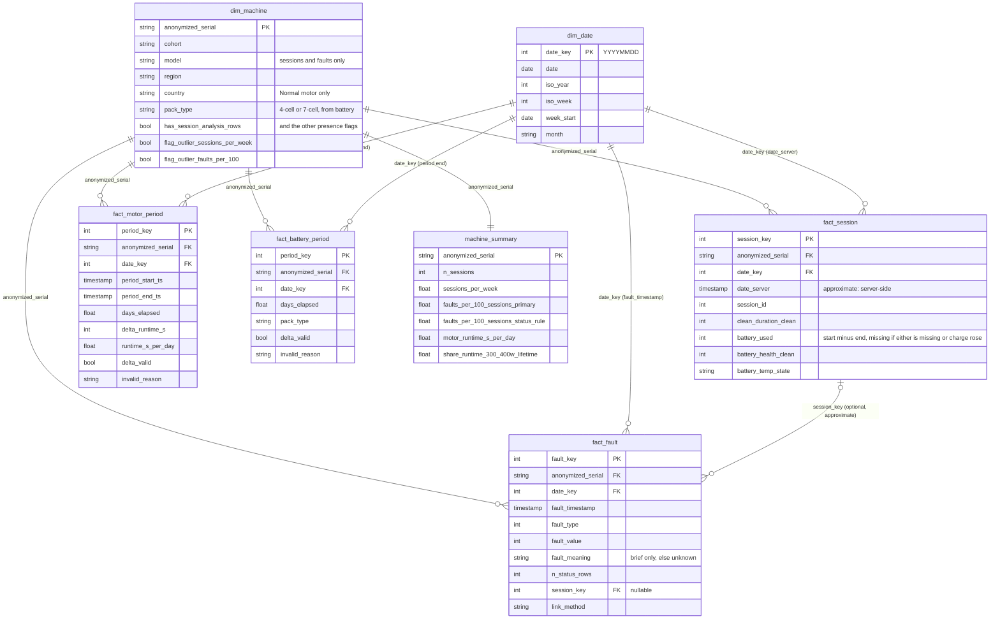

# Data model (Step 5)

Star schema built by `src/model.py` from the flagged tables in `data/clean/dq/` (rows with `is_analysis_row = True` only; faults use the primary rule). Output in `data/model/` as Parquet and CSV (the CSV files are the Tableau source). Checks: `reports/model/model_checks.csv`.

Cohort (`normal` / `return_repair`) is a column in `dim_machine` and is repeated in each fact table for convenience (a check confirms it always equals the `dim_machine` value). One code path serves both cohorts.

Only key and headline columns are drawn. Each fact has more columns (see the docstring of `src/model.py` and the CSV headers): `delta_*` columns hold one cumulative-bin delta each (motor: runtime, 25 speed, 14 power and 7 exhaust bins; battery: the 125 bin columns).

## Grain of each table

| Table | Grain (one row is...) | Date used |
|---|---|---|
| `dim_machine` | one machine (`anonymized_serial`); all 232 serials in `machine_dq`, including machines with no analysis row (flag `has_any_analysis_row`) | n/a |
| `dim_date` | one calendar day, continuous from the earliest to the latest fact date | n/a |
| `fact_session` | one analysis session: serial + `session_id` + `date_server` after the Step 4 duplicate rules | `date_server` (server-side, approximate) |
| `fact_fault` | one fault occurrence under the primary rule: serial + `session_id` + `fault_type` + `fault_value` + `fault_timestamp` | `fault_timestamp` |
| `fact_motor_period` | one interval between two consecutive analysis motor snapshots of a machine, ordered by `event_ts`. The first snapshot has no row | `event_ts` of the period end |
| `fact_battery_period` | same, for battery snapshots | `event_ts` of the period end |
| `machine_summary` | one machine; per-machine metrics, each with its sample size | n/a |

## Rules worth knowing

- **Periods, not weeks.** Snapshot spacing is uneven (median gap about 22 days for Normal motor, 7-8 days elsewhere), so each row is one interval with `days_elapsed` and per-day rates.
- **Counter decreases.** If any cumulative counter falls between the two snapshots, every delta of that period is missing, `delta_valid = False`, `invalid_reason = 'counter_decrease'`, and `n_decreasing_fields` says how many counters fell. A decrease is never treated as a reset and the row is kept.
- **Event time.** `ts_fallback_any` marks a period whose start or end snapshot used `server_timestamp` instead of a future `hdr_timestamp`.
- **Fault-to-session link.** `fact_fault.session_key` is the session with the same serial and `session_id` whose `date_server` is nearest to `fault_timestamp` (ties: lowest `session_key`); blank if there is no such session. It is approximate because `date_server` is server-side time and can trail the event by hours to weeks. `link_gap_hours` is the absolute gap. Motor and battery have no link to sessions (their `session_id` is a different counter).
- **Fault meaning** comes from the brief only. A fault type or value not in the brief reads "unknown". `fault_status` is not in the model (its meaning is unknown); `n_status_rows` counts the status-rule rows behind one occurrence, and `flag_occ_multi_status` marks occurrences seen with more than one status.
- **Blank vs zero.** In `machine_summary` a metric is blank when its input is missing: no sessions, fewer than 10 analysis sessions (per-session rates), or no valid motor period (runtime per day). Fault rates treat absence from the faults table as no faults [assumed], so a machine with 10 or more sessions and no fault rows gets 0. The sensitivity columns `faults_per_100_fault_machines_only_primary` and `..._status_rule` leave those machines blank.
