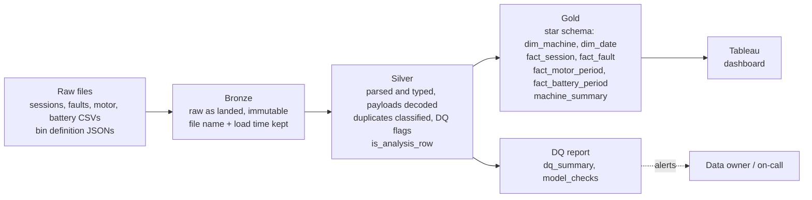

# Productionization sketch

How the take-home pipeline would run as a production data product. Today the same layers exist as folders: raw CSVs, `data/clean/` and `data/clean/dq/`, `data/model/`.

| Layer | Local equivalent | Script |
|---|---|---|
| Bronze | `normal_machines/`, `return_repair_machines/`, `reference_files/` | none (read-only) |
| Silver | `data/clean/`, `data/clean/dq/` | `build_clean.py`, `dq.py` |
| Gold | `data/model/` | `model.py` |

- **Scheduling.** Run the three scripts in order once a week, after the weekly device uploads land. An orchestrator (Airflow, Dagster or a cron job) handles retries and dependencies; a failed step stops the later ones.
- **Incremental loads.** Land each new file in bronze by date and never edit it. Silver can reprocess only new files, but deltas depend on the previous snapshot of each machine, so gold periods are rebuilt for any machine with new snapshots. Duplicate rules need history (the earliest copy wins), so keep a keyed table of seen rows.
- **DQ monitoring.** `dq_summary.csv` and `model_checks.csv` are the monitoring tables. Track them per load and keep the history to see drift.
- **Alerting.** Fail the load on any `FAIL` in `model_checks.csv`. Warn on shifts that signal upstream change: share of empty battery payloads, share of duplicate rows, counter decreases, new fault types not in the brief, serials missing from a table, and row counts that drop against the previous load.
- **Contracts.** Agree field definitions with the data owner (see "Additional data needed" in the assumptions log) so unknown fields can be documented rather than guessed.
- **At scale.** Replace local Parquet with a warehouse or lakehouse (partition by load date), run DuckDB/pandas logic as SQL or Spark, build the 125 battery bin columns as a long table, publish gold as a Tableau extract or live connection, and add privacy controls on the serial numbers.
